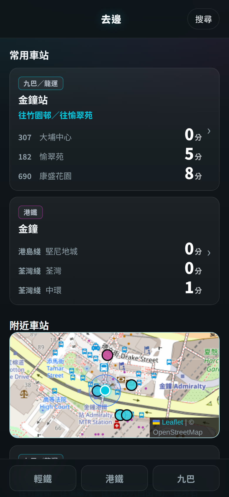
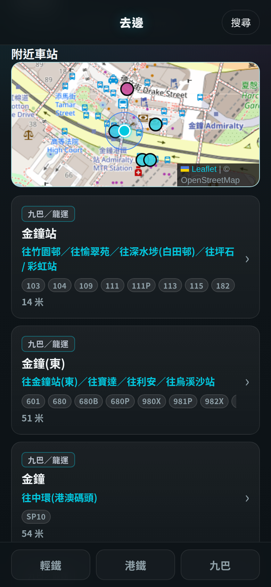
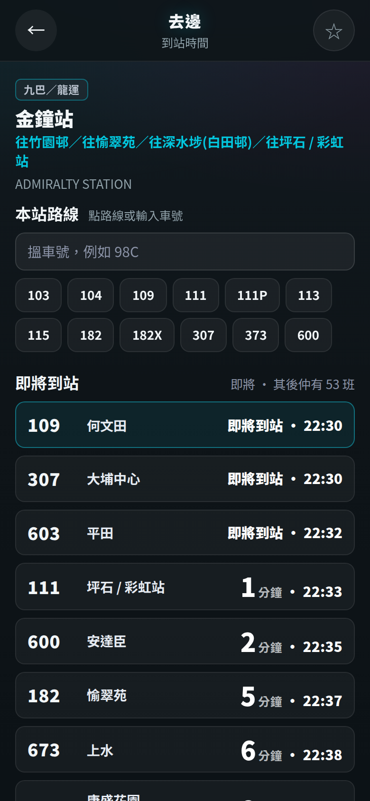

# 去邊 (heui-bin)

Hong Kong commute PWA. Open it on a phone and the next bus or train is already on the screen.

It is for a commute you already know: KMB and LWB stops, MTR Light Rail (including the stops along a route), and MTR heavy rail, including the Tuen Ma Line. The UI is Cantonese (`zh-Hant-HK`). Saved stops stay on the phone. Location is used only to list nearby stops, and it is not uploaded. The footer credits 運輸署, 港鐵, and 九巴.

The site is static. The phone is the runtime: it calls the KMB and MTR open-data APIs itself, and Surge only serves the files. The share spelling is `heuibin`. The product name is 去邊.

## 畫面

| 常用車站 | 附近車站 | 到站時間 |
| --- | --- | --- |
|  |  |  |

## Live

| | |
|---|---|
| Surge hostname | https://tap-eta-hk.surge.sh |
| Custom domain on Surge Free | https://heuibin.codecoffee.online |

Both hosts serve the revision in [`rev.txt`](rev.txt) (currently `v20260827q`). Each origin keeps its own favorites.

`http://heuibin.codecoffee.online` still serves the same files. Install the PWA from the `https://` URL. Certificate status and the phone checklist are in [PRODUCTION.md](PRODUCTION.md).

## Run locally

Serve this repository. Nothing in it compiles, and there is no `package.json`.

```sh
python3 -m http.server 5173
```

Open http://127.0.0.1:5173/ . That origin is a secure context, so the service worker and geolocation can run. A `file://` URL will not load the module or the worker.

Before committing a snapshot:

```sh
bash scripts/check-snapshot.sh
```

## Deploy and update

Hosting is Surge’s free static plan. A push to `main` publishes both hostnames. The manual commands are the same ones CI runs. [PRODUCTION.md](PRODUCTION.md) is the runbook (certificate, phone checks, cache-header variants). [SHIPPED.md](SHIPPED.md) records what `v20260827q` changed. [PROGRESS.md](PROGRESS.md) is the status note.

### GitHub Actions

[`.github/workflows/ci.yml`](.github/workflows/ci.yml) has two jobs:

1. On pull requests and on pushes, `scripts/check-snapshot.sh` checks that `rev.txt`, `index.html`, `sw.js`, and `assets/index-<rev>.*` agree. The script exits if `.surgeignore` lists `rev.txt`.
2. After that check, a push to `main` publishes with `npx surge ./ tap-eta-hk.surge.sh` and then `npx surge ./ heuibin.codecoffee.online`.
3. The deploy job curls both `/rev.txt` URLs until the body matches the file in the repo.

The deploy job reads the repository secret `SURGE_TOKEN`. Create it from a machine already logged into the Surge account that owns both projects:

```sh
surge tokens add -m ci
gh secret set SURGE_TOKEN --repo hkclaw/heui-bin
```

An empty `SURGE_TOKEN` fails the job.

## Review

Pull requests are reviewed automatically by Cursor Bugbot. The settings live on `main` in [`.cursor/config/bugbot.yaml`](.cursor/config/bugbot.yaml): every push, including draft pull requests, with incremental comments and a summary comment. [`.cursor/BUGBOT.md`](.cursor/BUGBOT.md) tells the review what this PWA must not break. Autofix stays off.

Comment `cursor review` or `bugbot run` on a pull request to run it by hand.

Bugbot reads that file from the base branch, so a pull request cannot change its own review. If a new pull request stays silent, enable `hkclaw/heui-bin` in Cursor → Automations → Bugbot and set the author’s trigger to every push. A personal setting of “only when mentioned” overrides this file for that author’s pull requests.

### Manual publish

`CNAME` is `tap-eta-hk.surge.sh`. A publish with no hostname follows that file and updates only the `surge.sh` project. Pass each hostname. The CLI rewrites `CNAME` to the hostname you passed, so restore it afterwards.

```sh
surge ./ tap-eta-hk.surge.sh
surge ./ heuibin.codecoffee.online
git checkout -- CNAME
curl -fsS https://tap-eta-hk.surge.sh/rev.txt
curl -fsS https://heuibin.codecoffee.online/rev.txt
```

Both bodies should equal `rev.txt`. One hostname stays on its previous snapshot until you publish that hostname too.

### Revision, service worker, and the update banner

Ship these together. `scripts/check-snapshot.sh` enforces the lockstep.

1. Add `assets/index-<rev>.js` and `assets/index-<rev>.css`.
2. Point `index.html` at that revision: the `tap-eta-rev` meta tag, the inline `REV`, the module script, and the stylesheet. The page registers `/sw.js?rev=` plus that `REV`.
3. Write the same token as the single line of `rev.txt`. CI compares this file, and the post-deploy curl reads it on each host. Leave `rev.txt` out of `.surgeignore` so the publish uploads it.
4. In `sw.js`, bump the Workbox prefix (`heui-bin-<rev>`) and every cache name (`heui-bin-static-<rev>`, `heui-bin-icons-<rev>`, `heui-bin-catalogues-<rev>`, `heui-bin-kmb-eta-<rev>`, `heui-bin-mtr-eta-<rev>`). Precache the new JS and CSS hashes. Keep the `message` listener: `skipWaiting()` runs only after the page posts `{type:'SKIP_WAITING'}`.
5. Bump the `?rev=` string in `registerSW.js` in the same change. `index.html` registers `/sw.js` itself. `registerSW.js` repeats the banner logic, and `_headers` plus the service worker still name the file.
6. Add the previous `assets/index-<oldrev>.*` glob to `.surgeignore`.

On a phone that already has the PWA installed:

- The new worker installs and waits.
- The page shows the button 「有新版本 · 更新」.
- A tap posts `{type:'SKIP_WAITING'}`. When that worker reaches `activated`, the page reloads once.
- A first install has no previous controller, so the button stays hidden.

Inside `sw.js`, navigations, `/index.html`, `/rev.txt`, `/sw.js`, `/registerSW.js`, and `*.webmanifest` use `NetworkOnly`, so an open page can see the new worker.

`_headers` asks for:

| Path | `Cache-Control` |
|---|---|
| `/`, `/index.html`, `/rev.txt`, `/sw.js`, `/registerSW.js` | `no-store` |
| `/assets/*` | `public, max-age=0, must-revalidate` |

On 2026-10-18 both hosts answered those URLs with `public, max-age=0, must-revalidate` and an ETag. That still revalidates. A long `max-age` without `no-cache` or `must-revalidate` would pin an old `sw.js`, and the update banner would not appear. The accepted variants are in [PRODUCTION.md](PRODUCTION.md) under “Cache-header invariants”.

ETA responses are cached in the worker for 60 seconds (`NetworkFirst` on `data.etabus.gov.hk` and `rt.data.gov.hk`). A stop page also polls every 20 seconds.

## Layout

| Path | Role |
|---|---|
| `index.html` | Shell, revision meta, service-worker registration, update banner |
| `assets/index-<rev>.js`, `assets/index-<rev>.css` | App bundle for that revision. The current files are `assets/index-v20260827q.*` |
| `assets/eta-details.css`, `styles.css` | Detail layout and first-paint styles |
| `sw.js`, `workbox-4a6fc131.js` | Workbox 7.4.0 service worker |
| `registerSW.js` | Same banner logic; still part of the cache contract |
| `rev.txt` | One-line revision stamp. Publish it with every deploy |
| `_headers` | `Cache-Control` notes for Surge |
| `manifest.webmanifest`, `pwa-*.png`, icons | Installable PWA. Name 去邊, display `standalone`, language `zh-Hant-HK` |
| `data/` | Stop catalogues: KMB/LWB, Light Rail stations and route order, MTR, Tuen Ma Line |
| `CNAME` | Default Surge project, `tap-eta-hk.surge.sh` |
| `.surgeignore` | Paths left out of a publish. `rev.txt` stays off this list |
| `.github/workflows/ci.yml`, `scripts/check-snapshot.sh` | Check the snapshot, then publish `main` |
| `.cursor/config/bugbot.yaml`, `.cursor/BUGBOT.md` | Automatic pull request review |
| `docs/screenshots/` | Product shots used in this README |
| `PRODUCTION.md` | Production runbook |
| `PROGRESS.md` | Status notes |
| `SHIPPED.md` | What `v20260827q` changed |

Hash routes in the bundle: `#/`, `#/search`, `#/search/<query>`, `#/route/<route>`, `#/eta/<kmb\|lrt\|tml\|mtr>/<id>`.

## Stack

- Static HTML, CSS, and one minified JavaScript bundle.
- Hash router. Leaflet 1.9.4 and OpenStreetMap tiles draw the nearby-stop map.
- Workbox 7.4.0.
- `localStorage` keys: `tap-eta-favorites-v1`, `tap-eta-mode-filter-v1`, `tap-eta-recent-search-v1`, `tap-eta-entrance-v1`.
- Live times, requested by the phone:
  - KMB/LWB stops and ETA: `https://data.etabus.gov.hk/v1/transport/kmb/`
  - MTR schedule: `https://rt.data.gov.hk/v1/transport/mtr/getSchedule.php`
  - Light Rail schedule: `https://rt.data.gov.hk/v1/transport/mtr/lrt/getSchedule`
- Noto Sans TC from Google Fonts.
- Surge Free for both hostnames. The CI secret is `SURGE_TOKEN`.
